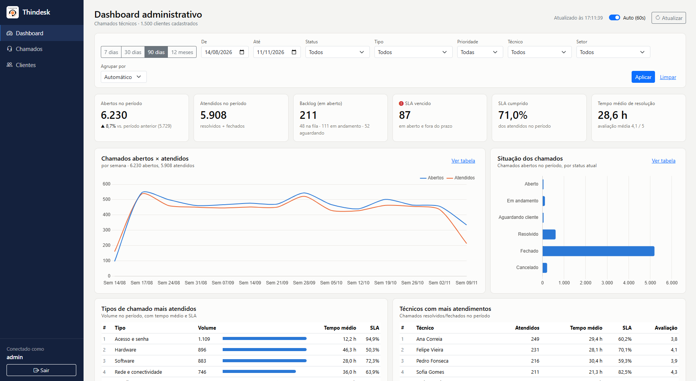

# Thindesk — Dashboard Administrativo

Painel administrativo para o sistema de chamados **Thindesk**, alimentado por uma API REST própria.
Atividade Prática M2 — Projeto e Desenvolvimento de Software Corporativo.



**Stack:** Java 17 · Spring Boot 4.1.1 (Web, Security, Data MongoDB, Validation) · MongoDB · Thymeleaf · Chart.js · JUnit 5 / Mockito

## Entregáveis

| Item | Onde |
|---|---|
| Requisitos funcionais e não funcionais | [docs/DOCUMENTACAO.md §2–3](docs/DOCUMENTACAO.md#2-requisitos-funcionais) |
| Documentação dos endpoints (parâmetros, exemplos, erros) | [docs/DOCUMENTACAO.md §7](docs/DOCUMENTACAO.md#7-documentação-da-api) · [docs/api.http](docs/api.http) |
| Evidências de testes | [docs/DOCUMENTACAO.md §8](docs/DOCUMENTACAO.md#8-testes-e-evidências) · [docs/evidencias](docs/evidencias) |
| Dashboard funcional | `/dashboard` · [docs/DOCUMENTACAO.md §9](docs/DOCUMENTACAO.md#9-dashboard-administrativo) |
| Código com Gitflow | branches `main`, `develop`, `feature/*`, `release/1.0.0` |
| Vídeo de apresentação | [docs/video.md](docs/video.md) |

## Executar

```bash
# Linux / macOS / Git Bash
export MONGODB_URI="mongodb+srv://<usuario>:<senha>@<cluster>.mongodb.net/thindesk?retryWrites=true&w=majority"
./mvnw spring-boot:run
```

```powershell
# Windows PowerShell
$env:MONGODB_URI = "mongodb+srv://<usuario>:<senha>@<cluster>.mongodb.net/thindesk?retryWrites=true&w=majority"
.\mvnw.cmd spring-boot:run
```

Acesse http://localhost:8080. Na primeira execução a base de demonstração é criada automaticamente
(**1.500 clientes, 40 técnicos, 42 usuários e 30.000 chamados em 18 meses**).

| Usuário | Senha | Perfil |
|---|---|---|
| `admin` | `Admin@123` | Administrador (dashboard) |
| `gestor` | `Gestor@123` | Gestor (dashboard) |
| `nome.sobrenome` de qualquer técnico | `Tecnico@123` | Técnico (sem dashboard) |

> Senhas de demonstração para ambiente acadêmico. A senha do admin pode ser trocada com `THINDESK_ADMIN_PASSWORD`.

## Testes

```bash
./mvnw test                     # 51 testes unitários e de contrato da API (sem banco)
./scripts/testar-api.sh         # 25 cenários HTTP contra a aplicação rodando; salva em docs/evidencias/api
```

## Endpoints

| Método | Caminho | Requisito |
|---|---|---|
| GET | `/api/v1/dashboard/resumo` | RF01 indicadores |
| GET | `/api/v1/dashboard/chamados-por-periodo` | RF02 série temporal |
| GET | `/api/v1/dashboard/status` | RF03 situação |
| GET | `/api/v1/dashboard/tipos` | RF04 tipos mais atendidos |
| GET | `/api/v1/dashboard/tecnicos` | ranking de técnicos |
| GET | `/api/v1/dashboard/distribuicao/{prioridade\|setor\|canal\|tipo}` | distribuições |
| GET | `/api/v1/dashboard/filtros` | RF05 opções de filtro |
| GET | `/api/v1/chamados` · `/api/v1/chamados/{id}` | consulta |
| POST | `/api/v1/chamados` | abertura |
| PATCH | `/api/v1/chamados/{id}/status` | RF07 atualização |
| GET | `/api/v1/clientes` · `/api/v1/tecnicos` | apoio |

## Estrutura

```
src/main/java/com/pfc/thindesk
├── config/          segurança, relógio, formatação
├── controller/api/  endpoints REST
├── controller/web/  páginas Thymeleaf
├── dto/             contratos da API (records)
├── entity/          documentos MongoDB e enums
├── exception/       erros de negócio e handler global
├── repository/      Spring Data + agregações do dashboard
├── seed/            base de demonstração e normalização
└── service/         regras de negócio
```
