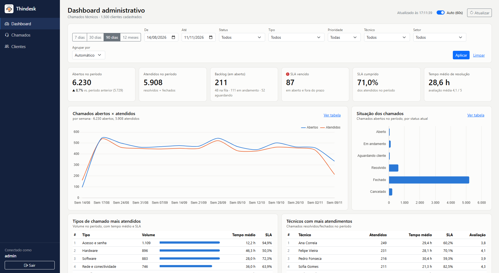

# Thindesk — Dashboard Administrativo de Chamados

**Disciplina:** Projeto e Desenvolvimento de Software Corporativo — Atividade Prática M2
**Base:** sistema de chamados Thindesk + atividade de Login Seguro (Spring Security, BCrypt, MongoDB)

---

## Sumário

1. [Visão geral](#1-visão-geral)
2. [Requisitos funcionais](#2-requisitos-funcionais)
3. [Requisitos não funcionais](#3-requisitos-não-funcionais)
4. [Arquitetura e decisões de projeto](#4-arquitetura-e-decisões-de-projeto)
5. [Modelagem de dados](#5-modelagem-de-dados)
6. [Regras de negócio e definição dos indicadores](#6-regras-de-negócio-e-definição-dos-indicadores)
7. [Documentação da API](#7-documentação-da-api)
8. [Testes e evidências](#8-testes-e-evidências)
9. [Dashboard administrativo](#9-dashboard-administrativo)
10. [Como executar](#10-como-executar)
11. [Versionamento (Gitflow)](#11-versionamento-gitflow)

---

## 1. Visão geral

O Thindesk é um sistema de chamados técnicos (help desk). Esta entrega acrescenta a ele um **Dashboard Administrativo**: um painel que mostra ao responsável pelo suporte o andamento dos chamados, a situação de cada status, as considerações técnicas registradas e os dados que ajudam na tomada de decisão (volume, SLA, tempo de resolução, tipos mais frequentes e desempenho dos técnicos).

O painel não lê o banco diretamente: ele consome uma **API REST** (`/api/v1/...`) projetada para esta atividade. A API faz os cálculos no próprio MongoDB (Aggregation Framework) e devolve só o resultado.

**Stack** (a mesma da atividade de Login Seguro, como confirmado pelo professor):

| Camada | Tecnologia |
|---|---|
| Linguagem | Java 17 |
| Framework | Spring Boot 4.1.1 (Web MVC, Security, Data MongoDB, Validation) |
| Banco | MongoDB (Atlas ou local) |
| Páginas | Thymeleaf + Bootstrap 5 |
| Gráficos | Chart.js 4 (consumindo a API via `fetch`) |
| Testes | JUnit 5, Mockito, AssertJ, MockMvc |
| Build | Maven (wrapper `mvnw` incluso) |

**Base de dados de demonstração:** na primeira execução, a aplicação gera automaticamente **1.500 clientes, 40 técnicos, 42 usuários de login e 30.000 chamados distribuídos em 18 meses** (seção 5.3).

---

## 2. Requisitos funcionais

| ID | Requisito | Como foi atendido | Endpoint / tela |
|---|---|---|---|
| **RF01** | Indicadores gerais de chamados técnicos | 6 cartões: abertos no período (com variação em relação ao período anterior), atendidos, backlog, SLA vencido, % de SLA cumprido e tempo médio de resolução + avaliação média | `GET /api/v1/dashboard/resumo` |
| **RF02** | Análise de chamados atendidos por período (gráficos) | Gráfico de linhas "abertos × atendidos" agrupado por dia, semana ou mês (automático conforme o tamanho do período); períodos sem chamados aparecem com zero | `GET /api/v1/dashboard/chamados-por-periodo` |
| **RF03** | Situação dos chamados | Gráfico de barras por status, com percentual; tabela com as últimas atualizações e **considerações técnicas**; tela de chamados com o status de cada um | `GET /api/v1/dashboard/status`, `GET /api/v1/chamados` |
| **RF04** | Tipos de chamados mais atendidos | Ranking de tipos com volume, tempo médio e % de SLA; ranking de técnicos; distribuição por prioridade e setor | `GET /api/v1/dashboard/tipos`, `/tecnicos`, `/distribuicao/{dimensao}` |
| **RF05** | Filtros de consulta | Período (atalhos 7/30/90 dias e 12 meses, ou datas livres), status, tipo, prioridade, técnico, setor e agrupamento. Os mesmos filtros valem para todos os endpoints. Os filtros ficam na URL, então o link do painel filtrado pode ser compartilhado | Todos os endpoints + `GET /api/v1/dashboard/filtros` |
| **RF06** | Integração com a API | O HTML é renderizado pelo Thymeleaf (opções de filtro); indicadores, gráficos e tabelas são carregados por `fetch()` nos endpoints REST, em paralelo | `static/js/dashboard.js` |
| **RF07** | Atualização e tratamento de dados | **Atualização:** recarga automática a cada 60 s (pode ser desligada), botão "Atualizar", recarga ao voltar para a aba; mudança de status pela API ou pela tela de chamados aparece no painel. **Tratamento:** validação de parâmetros, normalização de texto, preenchimento de períodos vazios, "Não atribuído" para técnico nulo, conversão de minutos para horas, arredondamento, conversão de registros antigos do Thindesk, mensagens de erro padronizadas | `PATCH /api/v1/chamados/{id}/status`, `NormalizadorDadosLegados` |

Requisitos complementares implementados:

| ID | Requisito |
|---|---|
| RF08 | Autenticação com usuário e senha (BCrypt) e perfis: `ROLE_ADMIN`, `ROLE_MANAGER` (gestor) e `ROLE_USER` (técnico) |
| RF09 | Abertura de chamado pela API, com cálculo automático do prazo de SLA |
| RF10 | Consulta paginada de chamados e clientes, com busca |

---

## 3. Requisitos não funcionais

| ID | Categoria | Requisito | Como foi atendido |
|---|---|---|---|
| RNF01 | Desempenho | Os endpoints do dashboard devem responder rapidamente com dezenas de milhares de chamados | Agregações executadas no MongoDB (`$match`, `$group`, `$dateToString`), sem trazer documentos para a aplicação; índices em `status`, `tipo`, `tecnico`, `dataAbertura`, `dataFechamento` e índices compostos; `tempoResolucaoMin` e `slaCumprido` calculados no fechamento (evita cálculo de datas a cada consulta) |
| RNF02 | Segurança | Acesso restrito e credenciais protegidas | Senhas com BCrypt; dashboard só para ADMIN/MANAGER; cadastro público cria apenas `ROLE_USER`; CSRF ativo nos formulários; cookie de sessão `HttpOnly` e `SameSite=Lax`; a connection string do banco vem da variável `MONGODB_URI` (não fica no código) |
| RNF03 | Confiabilidade | Erros não podem derrubar o painel nem expor detalhes internos | `ApiExceptionHandler` devolve JSON padronizado (400/401/403/404/422/500) sem stack trace; o front carrega cada bloco de forma independente (`Promise.allSettled`): se um falhar, os outros continuam e um alerta explica o problema |
| RNF04 | Usabilidade | Painel legível e responsivo | Filtros em uma linha acima dos gráficos; layout se adapta a telas menores; números no formato brasileiro; tooltips nos gráficos |
| RNF05 | Acessibilidade | A informação não pode depender só de cor | Status com rótulo de texto; cada gráfico principal tem a opção "Ver tabela"; gráficos de uma cor só para magnitudes; ícone + texto no indicador de SLA vencido |
| RNF06 | Manutenibilidade | Código organizado em camadas | Controller → Service → Repository; DTOs imutáveis (`record`); regras de negócio isoladas e testáveis; consultas agregadas atrás da interface `DashboardConsultas` |
| RNF07 | Testabilidade | Regras que dependem de data/hora devem ser testáveis | `Clock` injetado como bean; testes usam relógio fixo |
| RNF08 | Portabilidade | Rodar em qualquer máquina com JDK 17 | Maven Wrapper; MongoDB Atlas ou local; dados de demonstração gerados automaticamente |
| RNF09 | Versionamento | Código no GitHub com Gitflow | Branches `main`, `develop`, `feature/*`, `release/*` (seção 11) |
| RNF10 | Interoperabilidade | API utilizável por outros sistemas | REST + JSON, versionada (`/api/v1`), datas ISO-8601, autenticação HTTP Basic para integrações |

---

## 4. Arquitetura e decisões de projeto

```
 Navegador
 ├── /dashboard (HTML Thymeleaf) ──────────────► PainelController ──► DashboardService.opcoesFiltro()
 └── dashboard.js ── fetch() JSON ──► /api/v1/dashboard/* ─► DashboardApiController
                                      /api/v1/chamados/*  ─► ChamadoApiController
                                                                 │
                                                     DashboardService / ChamadoService
                                                     (validação, regras, tratamento)
                                                                 │
                                                  DashboardConsultas (interface)
                                                  MongoDashboardConsultas (Aggregation)
                                                                 │
                                                             MongoDB
                                        coleções: chamados · clientes · tecnicos · usuarios
```

Pacotes (`src/main/java/com/pfc/thindesk`):

| Pacote | Responsabilidade |
|---|---|
| `entity` | Documentos do MongoDB (`Chamado`, `Cliente`, `Tecnico`, `Usuario`) e enums `StatusChamado`, `Prioridade` |
| `dto` | Contratos da API (`record`s): filtros, respostas, requisições, erro |
| `repository` | Spring Data + `MongoDashboardConsultas` (agregações) |
| `service` | Regras de negócio |
| `controller.api` | Endpoints REST |
| `controller.web` | Páginas Thymeleaf |
| `exception` | Exceções de negócio e tratamento global de erros |
| `config` | Segurança, `Clock`, formatação |
| `seed` | Geração da base de demonstração e normalização de dados antigos |

**Principais decisões e justificativas**

1. **API separada do HTML (RF06).** O Thymeleaf monta a página e as opções dos filtros; os números vêm da API. Assim, o mesmo endpoint serve o painel, o Postman ou outro sistema, e o painel atualiza os dados sem recarregar a página.
2. **Cálculo no banco.** Em vez de carregar 30 mil chamados em memória e contar em Java, a API usa o Aggregation Framework. Pela rede trafegam só algumas linhas por consulta.
3. **Desnormalização proposital.** O chamado guarda o nome do técnico e do cliente além dos IDs, e guarda `tempoResolucaoMin` e `slaCumprido` calculados no fechamento. Num banco de documentos isso evita "joins" (`$lookup`) e deixa as agregações simples e rápidas. O custo é atualizar o nome se um técnico mudar de nome, o que é raro.
4. **Duas bases de data.** Indicadores de *volume* usam `dataAbertura`; indicadores de *atendimento* (atendidos, SLA, tempo médio, ranking de técnicos) usam `dataFechamento`. Dessa forma, "atendidos em outubro" significa chamados resolvidos em outubro, mesmo que tenham sido abertos em setembro.
5. **Enums para status e prioridade.** Evita variações como "Aberto"/"aberto"/"ABERTO", que no Thindesk original geravam categorias duplicadas. A máquina de estados fica no próprio enum (`podeIrPara`).
6. **Fuso horário explícito.** Datas são gravadas em UTC e agrupadas no fuso `America/Sao_Paulo` (`$dateToString` com `timezone`). Sem isso, um chamado aberto às 22h seria contado no dia seguinte.
7. **Respostas de erro únicas.** Toda falha devolve `{timestamp, status, erro, mensagem, caminho, detalhes}`, inclusive 401/403 (que por padrão redirecionariam para a tela de login).
8. **Melhorias sobre a atividade de Login.** A senha do banco saiu do `application.properties` e foi para variável de ambiente; o cadastro público não deixa escolher o perfil ADMIN; o CSRF foi reativado nos formulários.

---

## 5. Modelagem de dados

### 5.1 Coleções

**`chamados`** — campos do Thindesk original (`descricao`, `status`, `tipo`, `tecnico`, `usuario`) foram mantidos e ampliados:

| Campo | Tipo | Descrição |
|---|---|---|
| `_id` | ObjectId | Identificador |
| `protocolo` | string (único) | `TD-AAAA-NNNNNN` |
| `titulo`, `descricao` | string | Assunto e detalhes |
| `status` | enum | `ABERTO`, `EM_ANDAMENTO`, `AGUARDANDO_CLIENTE`, `RESOLVIDO`, `FECHADO`, `CANCELADO` |
| `tipo` | string | Ex.: Hardware, Rede e conectividade, Acesso e senha… (10 tipos) |
| `prioridade` | enum | `BAIXA` (SLA 72h), `MEDIA` (24h), `ALTA` (8h), `CRITICA` (4h) |
| `canal` | string | Portal, E-mail, Telefone, Presencial |
| `tecnicoId`, `tecnico` | string | Técnico responsável (nulo enquanto na fila) |
| `clienteId`, `usuario`, `setor` | string | Solicitante e setor |
| `dataAbertura` | data | Abertura |
| `dataPrimeiroAtendimento` | data | Primeira vez em andamento |
| `dataFechamento` | data | Resolução/cancelamento |
| `prazoSla` | data | `dataAbertura + horas de SLA da prioridade` |
| `slaCumprido` | boolean | `dataFechamento <= prazoSla` (calculado ao resolver) |
| `tempoResolucaoMin` | número | Minutos entre abertura e solução |
| `avaliacao` | 1–5 | Nota do solicitante ao fechar |
| `consideracaoTecnica` | string | Diagnóstico/solução registrada pelo técnico |
| `ultimaAtualizacao` | data | Última mudança |

Índices: `protocolo` (único), `status`, `tecnico`, `dataAbertura`, `dataFechamento`, `{status, dataAbertura}`, `{tipo, dataAbertura}`.

**`clientes`**: `nome`, `email` (único), `telefone`, `setor`, `unidade`, `dataCadastro`.
**`tecnicos`**: `nome`, `email`, `especialidade`, `nivel` (N1/N2/N3), `ativo`.
**`usuarios`**: `username` (único), `password` (hash BCrypt), `nome`, `role`.

### 5.2 Relacionamentos

```
Cliente 1 ───── N Chamado N ───── 0..1 Tecnico
                                   │
Usuario (login) ─ um por técnico + admin + gestor
```

### 5.3 Base de demonstração (classe `GeradorDeDados`)

Gerada na primeira execução (coleção `chamados` vazia). A semente é fixa, então a base é sempre a mesma.

| Item | Quantidade padrão | Variável para alterar |
|---|---|---|
| Clientes | 1.500 (12 setores, 7 unidades) | `THINDESK_SEED_CLIENTES` |
| Técnicos | 40 (6 especialidades, níveis N1–N3, 2 desligados) | `THINDESK_SEED_TECNICOS` |
| Chamados | 30.000 | `THINDESK_SEED_CHAMADOS` |
| Período | últimos 18 meses | `THINDESK_SEED_MESES` |
| Usuários de login | 42 (admin, gestor e um por técnico) | — |

Para os gráficos fazerem sentido, os dados seguem padrões reais de help desk: volume crescente ao longo dos meses, pico às segundas-feiras e pouco movimento no fim de semana, concentração entre 8h e 18h, menos chamados em janeiro e dezembro, tempo de resolução log-normal dependente da prioridade, do tipo e do nível do técnico, e status coerente com a idade do chamado (antigos fechados, recentes em aberto). Resultado aproximado: ~71% de SLA cumprido, ~3,5% cancelados e algumas centenas de chamados com SLA vencido.

---

## 6. Regras de negócio e definição dos indicadores

**Ciclo de vida do chamado**

```
ABERTO ──► EM_ANDAMENTO ──► RESOLVIDO ──► FECHADO
              │   ▲             │
              ▼   │             └──► EM_ANDAMENTO (reabertura)
      AGUARDANDO_CLIENTE ──► RESOLVIDO
(qualquer estado não finalizado) ──► CANCELADO
```

- Transição fora do diagrama → **422**.
- Para **RESOLVER** é obrigatório informar a consideração técnica → **422** se faltar.
- A **avaliação** (1–5) só é aceita ao **FECHAR**.
- Ao resolver: grava `dataFechamento`, `tempoResolucaoMin` e `slaCumprido`.
- Ao reabrir: limpa esses três campos.
- Ao entrar em andamento pela primeira vez: grava `dataPrimeiroAtendimento`.

**Indicadores** (para o período e os filtros escolhidos)

| Indicador | Definição |
|---|---|
| Abertos no período | chamados com `dataAbertura` no período |
| Variação | `(atual − anterior) / anterior × 100`, sendo o período anterior de mesmo tamanho e imediatamente antes; nulo se o anterior for zero |
| Backlog | abertos no período ainda em `ABERTO`, `EM_ANDAMENTO` ou `AGUARDANDO_CLIENTE` |
| SLA vencido | backlog com `prazoSla` anterior ao momento da consulta |
| Atendidos no período | chamados `RESOLVIDO`/`FECHADO` com `dataFechamento` no período |
| SLA cumprido | `atendidos dentro do prazo / atendidos com prazo × 100` |
| Tempo médio de resolução | média de `tempoResolucaoMin` dos atendidos, em horas |
| Avaliação média | média das notas dos atendidos |

**Filtros:** período padrão de 90 dias até hoje; máximo de 731 dias; agrupamento automático (até 45 dias → dia; até 180 → semana; acima → mês); agrupamento por dia limitado a 366 dias. Textos são normalizados (espaços extras removidos; vazio ou "todos" = sem filtro).

---

## 7. Documentação da API

### 7.1 Convenções

- **Base:** `http://localhost:8080/api/v1`
- **Autenticação:** sessão do navegador (após login) **ou** HTTP Basic (`-u usuario:senha`)
- **Perfis:** `/dashboard/**` exige `ROLE_ADMIN` ou `ROLE_MANAGER`; os demais endpoints exigem apenas usuário autenticado
- **Formato:** JSON UTF-8; datas de filtro `yyyy-MM-dd`; datas de resposta ISO-8601 em UTC
- **Usuários de demonstração:** `admin / Admin@123` (ADMIN), `gestor / Gestor@123` (MANAGER), técnicos `nome.sobrenome / Tecnico@123` (USER)

**Filtros comuns** (aceitos por todos os endpoints `/dashboard`, exceto `/filtros`):

| Parâmetro | Tipo | Padrão | Exemplo |
|---|---|---|---|
| `inicio` | data | hoje − 89 dias | `2026-08-01` |
| `fim` | data | hoje | `2026-10-31` |
| `status` | lista de enum (separada por vírgula) | todos | `ABERTO,EM_ANDAMENTO` |
| `tipo` | texto | todos | `Hardware` |
| `prioridade` | enum | todas | `CRITICA` |
| `tecnico` | texto (nome) | todos | `Ana Correia` |
| `setor` | texto | todos | `Financeiro` |

**Formato de erro** (todas as falhas):

```json
{
  "timestamp": "2026-11-11T17:02:11.418Z",
  "status": 400,
  "erro": "Bad Request",
  "mensagem": "A data inicial (2026-12-01) não pode ser maior que a data final (2026-01-01)",
  "caminho": "/api/v1/dashboard/resumo",
  "detalhes": []
}
```

| Código | Quando acontece |
|---|---|
| 200 / 201 | Sucesso / chamado criado (com cabeçalho `Location`) |
| 400 | Parâmetro com formato inválido, data inicial > final, período > 731 dias, granularidade/dimensão/status desconhecidos, `limite` fora de 1–50, paginação inválida, corpo JSON malformado ou campos obrigatórios ausentes (`detalhes` lista cada campo) |
| 401 | Requisição sem autenticação |
| 403 | Perfil sem permissão (ex.: técnico acessando o dashboard) |
| 404 | Chamado, cliente ou técnico não encontrado |
| 422 | Regra de negócio violada (transição de status inválida, resolver sem consideração técnica, avaliação fora do fechamento, status repetido) |
| 500 | Falha inesperada (ex.: banco indisponível); mensagem genérica, detalhes só no log |

---

### 7.2 `GET /dashboard/resumo` — Indicadores gerais (RF01)

Parâmetros: filtros comuns.

```bash
curl -u admin:Admin@123 "http://localhost:8080/api/v1/dashboard/resumo?inicio=2026-10-01&fim=2026-10-31"
```

```json
{
  "inicio": "2026-10-01",
  "fim": "2026-10-31",
  "totalAbertosNoPeriodo": 2065,
  "totalPeriodoAnterior": 2224,
  "variacaoPercentual": -7.1,
  "abertos": 0,
  "emAndamento": 20,
  "aguardandoCliente": 6,
  "resolvidos": 172,
  "fechados": 1794,
  "cancelados": 73,
  "backlog": 26,
  "atrasados": 26,
  "atendidosNoPeriodo": 2014,
  "taxaSla": 71.9,
  "tempoMedioResolucaoHoras": 28.3,
  "avaliacaoMedia": 4.1,
  "geradoEm": "2026-11-11T17:00:00Z"
}
```

Campos `variacaoPercentual`, `taxaSla`, `tempoMedioResolucaoHoras` e `avaliacaoMedia` podem ser `null` quando não há dados. Erros: 400, 401, 403.

### 7.3 `GET /dashboard/chamados-por-periodo` — Série temporal (RF02)

| Parâmetro extra | Valores | Padrão |
|---|---|---|
| `granularidade` | `AUTO`, `DIA`, `SEMANA`, `MES` | `AUTO` |

```bash
curl -u admin:Admin@123 "http://localhost:8080/api/v1/dashboard/chamados-por-periodo?inicio=2026-09-01&fim=2026-10-31&granularidade=MES"
```

```json
{
  "granularidade": "MES",
  "inicio": "2026-09-01",
  "fim": "2026-10-31",
  "totalAbertos": 4176,
  "totalAtendidos": 4011,
  "pontos": [
    { "periodo": "2026-09", "rotulo": "set/26", "abertos": 2111, "atendidos": 1997 },
    { "periodo": "2026-10", "rotulo": "out/26", "abertos": 2065, "atendidos": 2014 }
  ]
}
```

Chave do período: `AAAA-MM-DD` (dia), `AAAA-Wss` (semana ISO) ou `AAAA-MM` (mês). Erros: 400 (`granularidade=ANO`; `DIA` com mais de 366 dias), 401, 403.

### 7.4 `GET /dashboard/status` — Situação dos chamados (RF03)

```bash
curl -u admin:Admin@123 "http://localhost:8080/api/v1/dashboard/status?inicio=2026-10-01&fim=2026-10-31"
```

```json
[
  { "chave": "ABERTO",             "rotulo": "Aberto",             "total": 0,    "percentual": 0.0 },
  { "chave": "EM_ANDAMENTO",       "rotulo": "Em andamento",       "total": 20,   "percentual": 1.0 },
  { "chave": "AGUARDANDO_CLIENTE", "rotulo": "Aguardando cliente", "total": 6,    "percentual": 0.3 },
  { "chave": "RESOLVIDO",          "rotulo": "Resolvido",          "total": 172,  "percentual": 8.3 },
  { "chave": "FECHADO",            "rotulo": "Fechado",            "total": 1794, "percentual": 86.9 },
  { "chave": "CANCELADO",          "rotulo": "Cancelado",          "total": 73,   "percentual": 3.5 }
]
```

Todos os status aparecem, mesmo com zero. Erros: 400, 401, 403.

### 7.5 `GET /dashboard/tipos` — Tipos mais atendidos (RF04)

| Parâmetro extra | Tipo | Padrão |
|---|---|---|
| `limite` | inteiro 1–50 | 10 |

```bash
curl -u admin:Admin@123 "http://localhost:8080/api/v1/dashboard/tipos?inicio=2026-10-01&fim=2026-10-31&limite=3"
```

```json
[
  { "posicao": 1, "tipo": "Acesso e senha", "total": 378, "atendidos": 366, "percentual": 18.3, "tempoMedioResolucaoHoras": 13.4, "taxaSla": 95.1 },
  { "posicao": 2, "tipo": "Software",       "total": 288, "atendidos": 270, "percentual": 13.9, "tempoMedioResolucaoHoras": 28.7, "taxaSla": 72.2 },
  { "posicao": 3, "tipo": "Hardware",       "total": 274, "atendidos": 259, "percentual": 13.3, "tempoMedioResolucaoHoras": 46.6, "taxaSla": 48.6 }
]
```

Erros: 400 (`limite=0` ou `limite=500`), 401, 403.

### 7.6 `GET /dashboard/tecnicos` — Ranking de técnicos

Mesmos parâmetros de `/tipos`. Conta chamados **atendidos** no período (base `dataFechamento`).

```json
[
  { "posicao": 1, "tecnico": "Carla Ferreira", "atendidos": 79, "tempoMedioResolucaoHoras": 36.0, "taxaSla": 55.7, "avaliacaoMedia": 3.7 },
  { "posicao": 2, "tecnico": "Ana Correia",    "atendidos": 76, "tempoMedioResolucaoHoras": 27.0, "taxaSla": 59.2, "avaliacaoMedia": 3.7 }
]
```

### 7.7 `GET /dashboard/distribuicao/{dimensao}`

`dimensao` = `prioridade`, `setor`, `canal` ou `tipo`. Filtros comuns.

```bash
curl -u admin:Admin@123 "http://localhost:8080/api/v1/dashboard/distribuicao/prioridade"
```

```json
[
  { "chave": "BAIXA",   "rotulo": "Baixa",   "total": 635, "percentual": 30.8 },
  { "chave": "MEDIA",   "rotulo": "Média",   "total": 919, "percentual": 44.5 },
  { "chave": "ALTA",    "rotulo": "Alta",    "total": 373, "percentual": 18.1 },
  { "chave": "CRITICA", "rotulo": "Crítica", "total": 138, "percentual": 6.7 }
]
```

Erros: 400 (`/distribuicao/cor`), 401, 403.

### 7.8 `GET /dashboard/filtros` — Opções de filtro (RF05)

Sem parâmetros. Retorna listas para preencher os filtros e o intervalo de datas existente na base.

```json
{
  "status": [ { "valor": "ABERTO", "rotulo": "Aberto" }, "..." ],
  "prioridades": [ { "valor": "BAIXA", "rotulo": "Baixa" }, "..." ],
  "tipos": [ "Acesso e senha", "E-mail", "Hardware", "..." ],
  "tecnicos": [ "Alessandra Duarte", "Ana Correia", "..." ],
  "setores": [ "Atendimento ao Cliente", "Comercial", "..." ],
  "dataMinima": "2025-05-11",
  "dataMaxima": "2026-11-11"
}
```

### 7.9 `GET /chamados` — Lista paginada

| Parâmetro | Tipo | Padrão |
|---|---|---|
| `status` | lista de enum | todos |
| `tipo`, `tecnico` | texto | — |
| `busca` | texto (protocolo, título ou solicitante; sem diferenciar maiúsculas) | — |
| `inicio`, `fim` | data de abertura | — |
| `pagina` | inteiro ≥ 0 | 0 |
| `tamanho` | 1–100 | 20 |
| `ordenarPor` | `dataAbertura`, `dataFechamento`, `prioridade`, `status`, `tipo`, `protocolo` | `dataAbertura` |
| `direcao` | `asc`, `desc` | `desc` |

```bash
curl -u admin:Admin@123 "http://localhost:8080/api/v1/chamados?status=ABERTO&tamanho=1"
```

```json
{
  "conteudo": [
    {
      "id": "6733a1f0c2b4e15a8f0d2a11",
      "protocolo": "TD-2026-030000",
      "titulo": "Instalar certificado digital",
      "descricao": "Solicitação registrada por Bianca Dias (Jurídico - Curitiba): instalar certificado digital.",
      "status": "ABERTO",
      "tipo": "Instalação",
      "prioridade": "ALTA",
      "canal": "Presencial",
      "tecnicoId": null,
      "tecnico": null,
      "clienteId": "6733a1e9c2b4e15a8f0c1b07",
      "usuario": "Bianca Dias",
      "setor": "Jurídico",
      "dataAbertura": "2026-11-11T16:59:29Z",
      "dataPrimeiroAtendimento": null,
      "dataFechamento": null,
      "prazoSla": "2026-11-12T00:59:29Z",
      "ultimaAtualizacao": "2026-11-11T16:59:29Z",
      "slaCumprido": null,
      "tempoResolucaoMin": null,
      "avaliacao": null,
      "consideracaoTecnica": null
    }
  ],
  "pagina": 0,
  "tamanho": 1,
  "totalElementos": 55,
  "totalPaginas": 55
}
```

Erros: 400 (`tamanho=1000`, `ordenarPor=senha`), 401.

### 7.10 `GET /chamados/{id}`

Retorna um chamado. Erros: 401, 404.

### 7.11 `POST /chamados` — Abrir chamado

Corpo:

| Campo | Obrigatório | Regra |
|---|---|---|
| `titulo` | sim | até 120 caracteres |
| `descricao` | não | até 2000 caracteres |
| `tipo` | sim | texto |
| `prioridade` | sim | `BAIXA`, `MEDIA`, `ALTA`, `CRITICA` |
| `clienteId` | sim | deve existir |
| `tecnicoId` | não | deve existir |
| `canal` | não | padrão `Portal` |

```bash
curl -u admin:Admin@123 -X POST http://localhost:8080/api/v1/chamados \
  -H "Content-Type: application/json" \
  -d '{"titulo":"Monitor não liga","tipo":"Hardware","prioridade":"ALTA","clienteId":"6733a1e9c2b4e15a8f0c1b07"}'
```

Resposta **201** com `Location: /api/v1/chamados/{id}` e o chamado criado (`status: ABERTO`, `prazoSla = abertura + 8h`).

Erro 400 (campos ausentes):

```json
{
  "status": 400,
  "erro": "Bad Request",
  "mensagem": "Dados da requisição inválidos",
  "caminho": "/api/v1/chamados",
  "detalhes": [
    "clienteId: clienteId é obrigatório",
    "prioridade: prioridade é obrigatória",
    "tipo: tipo é obrigatório",
    "titulo: titulo é obrigatório"
  ]
}
```

Outros erros: 401, 404 (cliente/técnico inexistente).

### 7.12 `PATCH /chamados/{id}/status` — Atualizar status (RF07)

| Campo | Obrigatório | Regra |
|---|---|---|
| `status` | sim | próximo status permitido (seção 6) |
| `consideracaoTecnica` | ao resolver | até 2000 caracteres |
| `avaliacao` | não | 1–5, apenas com `FECHADO` |

```bash
curl -u admin:Admin@123 -X PATCH http://localhost:8080/api/v1/chamados/{id}/status \
  -H "Content-Type: application/json" \
  -d '{"status":"RESOLVIDO","consideracaoTecnica":"Fonte substituída; equipamento testado por 30 minutos."}'
```

Resposta **200** com o chamado atualizado (`dataFechamento`, `tempoResolucaoMin` e `slaCumprido` preenchidos).

Erro 422 (transição inválida):

```json
{
  "status": 422,
  "erro": "Unprocessable Entity",
  "mensagem": "Transição de status não permitida: Aberto → Fechado. Permitidas: [EM_ANDAMENTO, CANCELADO]",
  "caminho": "/api/v1/chamados/6733a1f0c2b4e15a8f0d2a11/status",
  "detalhes": []
}
```

Outros erros: 400 (status desconhecido, avaliação fora de 1–5, JSON inválido), 401, 404.

### 7.13 `GET /clientes` e `GET /tecnicos`

- `GET /clientes?nome=&pagina=0&tamanho=20` → página de clientes (busca por nome sem diferenciar maiúsculas).
- `GET /tecnicos` → técnicos ativos em ordem alfabética.

Arquivo pronto com todas as requisições: [`docs/api.http`](api.http).

---

## 8. Testes e evidências

### 8.1 Testes automatizados

Rodar: `./mvnw test` (Windows: `.\mvnw.cmd test`). Não precisam de banco.

| Classe | O que valida | Casos |
|---|---|---|
| `StatusChamadoTest` | Máquina de estados do chamado | 3 |
| `DashboardServiceTest` | Período padrão e fuso; datas invertidas; período máximo; normalização de filtros; cálculo dos indicadores (backlog, SLA, horas, variação, arredondamento); base vazia sem divisão por zero; período anterior; granularidade automática; série com períodos vazios preenchidos; semanas ISO na virada do ano; distribuição com todos os status; dimensão inválida; rankings; "Não atribuído"; limite inválido | 16 |
| `ChamadoServiceTest` | Primeiro atendimento; SLA cumprido e violado; tempo de resolução; consideração técnica obrigatória; transição proibida; avaliação só ao fechar; reabertura; 404; abertura com protocolo e prazo de SLA | 11 |
| `DashboardApiControllerTest` | Contrato HTTP: JSON de resposta; conversão dos filtros da URL; 400 para data, granularidade, status e limite inválidos; 500 sem expor detalhes | 9 |
| `ChamadoApiControllerTest` | 404; 400 com lista de campos inválidos; 201 com `Location`; JSON malformado; avaliação fora do intervalo; 422 para transição; paginação inválida | 8 |
| `GeradorDeDadosTest` | Base gerada: quantidades, unicidade, datas coerentes, SLA coerente com o prazo, determinismo | 4 |
| `ApiIntegracaoIT` (opcional) | Aplicação completa + MongoDB real: 401 sem login, 403 para técnico, total do resumo igual à soma por status, erros 400/404, `PATCH` reduz o backlog no dashboard e transição inválida → 422 | 5 |

O teste de integração só roda com um banco de teste configurado:

```bash
export MONGODB_URI_TESTE="mongodb+srv://<usuario>:<senha>@<cluster>.mongodb.net/thindesk_teste"
./mvnw test -Dtest=ApiIntegracaoIT
```

### 8.2 Testes da API (manuais/automatizados com curl)

Com a aplicação rodando, `./scripts/testar-api.sh` (Git Bash no Windows) executa **25 cenários** (sucesso e erro), salva cada resposta em `docs/evidencias/api/` e gera `00-resumo-dos-testes.txt` com esperado × obtido.

| # | Cenário | Esperado |
|---|---|---|
| 01–10 | Todos os endpoints de consulta, com e sem filtros | 200 |
| 11 | Sem login | 401 |
| 12 | Técnico acessando o dashboard | 403 |
| 13–17 | Datas invertidas, data mal formatada, granularidade, dimensão e limite inválidos | 400 |
| 18 | Chamado inexistente | 404 |
| 19 | Abertura sem campos obrigatórios | 400 |
| 20 | Abertura válida | 201 |
| 21 | Iniciar atendimento | 200 |
| 22 | Resolver sem consideração técnica | 422 |
| 23–24 | Resolver e fechar com avaliação | 200 |
| 25 | Voltar um chamado fechado para aberto | 422 |

### 8.3 Evidências

> Coloque aqui os prints/arquivos gerados na sua máquina:
>
> - `docs/evidencias/testes-unitarios.png` — saída do `./mvnw test` com `BUILD SUCCESS`
> - `docs/evidencias/api/00-resumo-dos-testes.txt` — resultado do script de API
> - `docs/evidencias/postman-erro-400.png` (opcional) — exemplo de erro no Postman/Insomnia
> - `docs/evidencias/atualizacao-status.png` — chamado alterado na tela de chamados e o indicador mudando no dashboard

---

## 9. Dashboard administrativo



Elementos do painel:

1. **Barra de filtros (RF05):** atalhos de período, datas, status, tipo, prioridade, técnico, setor e agrupamento.
2. **Indicadores (RF01):** abertos (com variação), atendidos, backlog (fila / em andamento / aguardando), SLA vencido, % SLA e tempo médio + avaliação.
3. **Abertos × atendidos (RF02):** quando a linha laranja fica abaixo da azul por várias semanas, a fila está crescendo.
4. **Situação dos chamados (RF03):** barras por status, com opção de tabela.
5. **Tipos mais atendidos e técnicos (RF04):** volume, tempo médio e SLA de cada tipo/técnico. Mostra, por exemplo, que "Hardware" tem o pior SLA, um bom ponto para decisão (estoque de peças, mais técnicos de infraestrutura).
6. **Prioridade e setor:** de onde vem a demanda.
7. **Últimas atualizações e considerações técnicas:** os 10 chamados mais recentes dentro dos filtros.
8. **Atualização (RF07):** automática a cada 60 s, botão manual e horário da última carga.

---

## 10. Como executar

Pré-requisitos: JDK 17+ e um MongoDB (Atlas gratuito M0 ou local).

```bash
# 1) banco (Linux/macOS/Git Bash)
export MONGODB_URI="mongodb+srv://<usuario>:<senha>@<cluster>.mongodb.net/thindesk?retryWrites=true&w=majority"
# Windows PowerShell:
# $env:MONGODB_URI = "mongodb+srv://<usuario>:<senha>@<cluster>.mongodb.net/thindesk?retryWrites=true&w=majority"

# 2) executar (a primeira subida gera a base, ~20-60 s no Atlas)
./mvnw spring-boot:run        # Windows: .\mvnw.cmd spring-boot:run

# 3) acessar
http://localhost:8080   ->  admin / Admin@123
```

Sem a variável `MONGODB_URI`, a aplicação tenta `mongodb://localhost:27017/thindesk`.

| Variável | Padrão | Uso |
|---|---|---|
| `MONGODB_URI` | `mongodb://localhost:27017/thindesk` | Conexão |
| `THINDESK_ADMIN_PASSWORD` | `Admin@123` | Senha do admin criado na carga |
| `THINDESK_SEED_ENABLED` | `true` | Liga/desliga a carga inicial |
| `THINDESK_SEED_RESET` | `false` | `true` apaga e recria chamados, clientes e técnicos |
| `THINDESK_SEED_CHAMADOS` | `30000` | Tamanho da base |

---

## 11. Versionamento (Gitflow)

| Branch | Função |
|---|---|
| `main` | Versão entregue (tag `v1.0.0`) |
| `develop` | Integração das funcionalidades |
| `feature/modelagem-dados` | Entidades, enums, repositórios, normalização de dados antigos |
| `feature/seguranca-login` | Login com BCrypt e perfis (base da atividade anterior), 401/403 em JSON |
| `feature/api-dashboard` | Endpoints `/api/v1/dashboard/*` e `/api/v1/chamados/*`, regras e tratamento de erros |
| `feature/carga-dados` | Geração da base de demonstração |
| `feature/dashboard-ui` | Páginas Thymeleaf, filtros e gráficos |
| `feature/testes-documentacao` | Testes, script de evidências e documentação |
| `release/1.0.0` | Preparação da entrega |

Cada `feature/*` sai de `develop` e volta para `develop` com merge `--no-ff`; `release/1.0.0` sai de `develop` e é mesclada em `main` e em `develop`.
